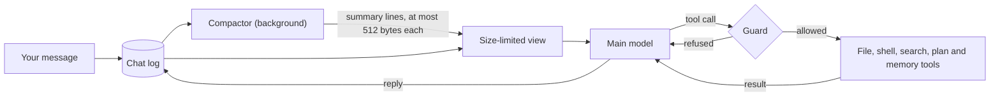
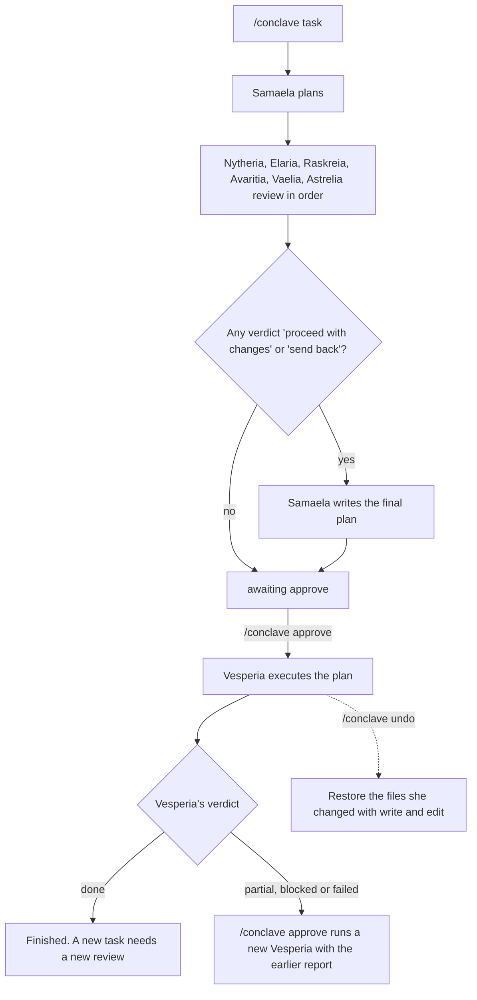
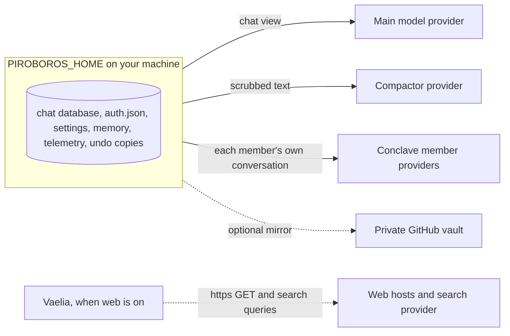

# piroboros

A Windows-first terminal agent harness built around one long-lived chat. Each turn sends a fresh request made from a size-limited view of the chat. A background compactor keeps that view small. A panel of review agents (the Conclave) runs one member at a time, each in its own child conversation.

> Status: early development. The setup wizard, the chat UI, `--print`, `--backup` and the guarded file and shell tools work. The compactor works (`/status` shows its work, its retries and whether it paused after errors). The Conclave pipeline works from the command line of the chat (`/conclave`) and has a side pane. The memory tools, the `/akashic` commands, the thinking panel and `SKILL.md` skills for the main chat work.

## Safety

piroboros runs the shell commands the model asks for, with the rights of your account. The guard is a tripwire, not a sandbox: it stops common mistakes, and a command can be worded around it. For untrusted tasks, use a throwaway directory or account. Web access is off by default. Undo copies can hold file contents unredacted.

More in [Privacy and limits](docs/privacy.md).

## Quickstart

```
npm install -g piroboros
piroboros
```

With no `main` model set, `piroboros` starts a guided wizard: it checks your environment, lets you pick (or skip) a compactor model, choose the main model and sign in, then writes `settings.json` once at the end. `piroboros setup` runs the same wizard later. piroboros has no install hook of its own. Some dependencies (`@google/genai`, `protobufjs`) run install scripts; `--ignore-scripts` is safe to use.

The package pins its dependencies to exact versions. The `overrides` in `package.json` apply only to installs made inside this repository; an install of the package resolves the same pins without them.

### From a source checkout

```
npm ci
npm run setup
npm start
```

A checkout runs the TypeScript sources directly. To type `piroboros` in any terminal from a checkout, run `npm link` once in the folder; `npm unlink -g piroboros` removes it.

## Requirements

- Node.js 26.5 or newer (a checkout runs the sources through Node's type stripping; the installed package runs compiled JavaScript).
- `bash` runs every shell command the model issues. On Windows install Git for Windows, which includes Git Bash; the WSL launcher is not used. Linux and macOS use their own bash.
- `git` for the optional memory vault, and `rg` (ripgrep) for exact search and as the fallback when fff cannot load.
- Windows and Linux are both targets.

## How a turn works



Every turn builds a new request from the view, so the request stays bounded as the chat grows. Until a compactor is configured, long messages show as "not summarized yet" lines and each request carries a window of at most 128 KB of the view. Your local log keeps the raw text.

## The Conclave

`/conclave <task>` starts a review by eight agents, each in its own child conversation, one at a time.



The reports are held while the pipeline runs and reach the chat together when the review waits for approval or the execution ends. `/conclave cancel` stops a run, `/conclave status` shows the current member and `zoom("Name")` shows a member's whole chat.

Who can do what:

| Seat | Read and search | Write files | Shell | Memory | Web |
| --- | --- | --- | --- | --- | --- |
| Root chat | yes | yes, not while a pipeline runs | yes, not while a pipeline runs | all three tools | no |
| Samaela and the reviewers | yes, plus `zoom` and `date` | no | no | `mnemosia_brief` only | Vaelia only, when `web.enabled` is on |
| Vesperia | yes | inside the working directory | yes | all three tools, records wait for `/akashic accept` | no |

Details: [The Conclave](docs/conclave.md).

## Where your data goes



A compactor on a third-party provider needs your consent (`compactor.allowThirdParty: true`). Details: [Privacy and limits](docs/privacy.md), [Web access](docs/web.md), [Memory](docs/memory.md).

## Commands at a glance

| Command | What it does |
| --- | --- |
| `piroboros` / `npm start` | Opens the chat; runs setup first when no main model is set |
| `piroboros setup` / `npm run setup` | Runs the guided setup |
| `--print <message>` | Sends one message and prints the answer |
| `--model provider/model` | Uses another model for that run only |
| `--backup <file>` | Writes a copy of the chat database |
| `/model`, `/settings`, `/login` | Change the main model, edit `settings.json`, sign in |
| `/reload`, `/status` | Re-read the config files, show the view and cache state |
| `/learn` | Learning loop: status, proposals, accept, reject, undo |
| `/telemetry` | Model requests, latency and cost of the last 24 hours |
| `/conclave <task>`, `approve`, `cancel`, `status`, `undo` | Run and control the Conclave |
| `/akashic` | Memory and vault commands |
| `/thinking-steps`, `/skills`, `/<skill-name>` | Thinking panel mode, skill list, run a skill |
| `/` as the first character | Opens the command list |
| Esc, Ctrl+C | Stop the turn and put your unanswered messages back in the input; Ctrl+C twice within 2 seconds exits |
| Ctrl+T, Alt+T | Next thinking level, next thinking-steps view |
| PgUp, PgDn, End | Scroll the chat, return to the newest line |

## Documentation

- [Configuration and commands](docs/configuration.md): `PIROBOROS_HOME`, `instructions.md`, `models.json`, command-line flags and exit codes, `/login`, `/settings`, `/reload`, `/status`
- [The Conclave](docs/conclave.md): the pipeline, the pane, approve, cancel, undo, retries, member models and limits
- [Interface](docs/interface.md): the command list, the screen layout, the look, thinking steps and keys
- [Memory](docs/memory.md): `akashic_memory`, `mnemosia_brief`, quarantine and the Git vault
- [Web access](docs/web.md): `web_fetch` and `web_search` for Vaelia, URL rules, limits and providers
- [Tools and skills](docs/tools.md): file search, the plan tool, loop limits and `SKILL.md` skills
- [Privacy and limits](docs/privacy.md): what each provider receives, scrubbing, traces and shell limits
- [Development](docs/development.md): typecheck, build and compactor prompt tuning

## License

MIT. See `LICENSE` and `NOTICE` (ported code and credits).

The chat design and prompts come from UniiChat/OptChat by VictorTaelin. The prompts are adapted from the gist (revision 3c190e06), not verbatim; NOTICE lists the changes.
